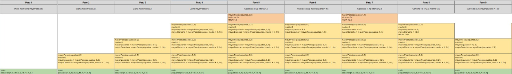
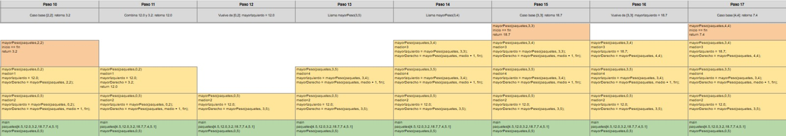
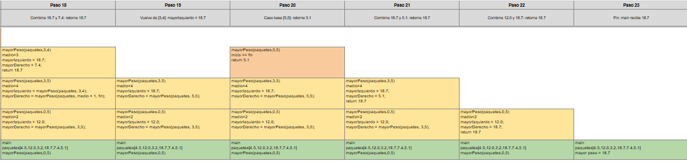
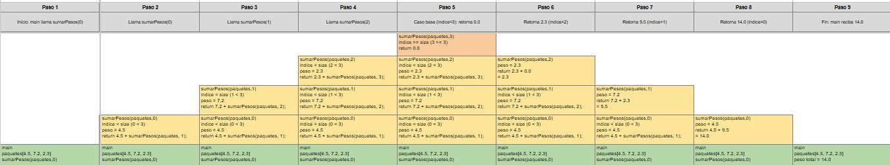

# Parcial 1

## Estructura de datos

**Juan Steban Acosta Ramirez:** 1090273599
**Juan Esteban Galeano Bolaños:** 1005087822

**Profesor:** Robinson Arias

**Universidad del Quindío**
Facultad de Ingeniería
Programa de Ingeniería de Sistemas y Computación
Armenia, Quindío, 2026

---

## Introducción

El proyecto QuindíoExpress consiste en desarrollar un sistema que permita gestionar paquetes y organizar su distribución de manera eficiente, para ello, se utilizan estructuras de datos y algoritmos que facilitan el almacenamiento, la búsqueda y el procesamiento de la información de cada paquete.

Durante el desarrollo se aplicaron conceptos de programación en Java, como: listas, pilas, recursividad, búsqueda binaria y división y conquista. Además, se analizaron los tiempos de ejecución de algunos algoritmos para comprender su funcionamiento y evaluar su eficiencia, el objetivo principal fue aplicar los conocimientos adquiridos en la asignatura de Estructuras de Datos mediante la construcción de una solución que facilite la gestión de paquetes y permita comprender la importancia de elegir las estructuras de datos y los algoritmos adecuados para resolver problemas.

---

## A. Selección de colecciones

En este apartado se identifican las estructuras de datos utilizadas en el proyecto QuindíoExpress y se explica por qué son adecuadas para almacenar, organizar y consultar la información de los paquetes. También se consideran las necesidades del sistema y la eficiencia de las estructuras seleccionadas.

| Necesidad | Estructura elegida | Operación principal | Complejidad esperada | Alternativa descartada | Justificación |
| --- | --- | --- | --- | --- | --- |
| Pendientes en orden exacto de registro | `ArrayList` | Agregar los paquetes al final y recorrerlos en el orden en que llegaron. | Agregar al final: O(1) amortizado; recorrer: O(n) | `LinkedList` | Se eligió `ArrayList` porque conserva el orden de registro y permite recorrer los paquetes eficientemente. En `RegistroCentro.java`, los paquetes se almacenan en `ordenLlegada`. Además, permite obtener una copia de los registros sin modificar la colección original. |
| Consultar un paquete por código | `HashMap` | Buscar un paquete por su código y comprobar si ya está registrado. | Consultar por código: O(1) en promedio | `ArrayList` | Se eligió `HashMap` porque permite recuperar un paquete mediante su código sin recorrer todos los registros. En `RegistroCentro.java`, el mapa `paquetesPorCodigo` también permite comprobar que no se registren códigos duplicados. |
| Municipios destino sin duplicados | `HashSet` | Agregar municipios y comprobar si ya existen. | Agregar y comprobar existencia: O(1) en promedio | `ArrayList` | Se eligió `HashSet` porque evita almacenar municipios duplicados y permite comprobar su existencia eficientemente. En `RegistroCentro.java`, el conjunto `municipios` almacena los destinos únicos. |
| Municipios ordenados y sin repetidos | `TreeSet` | Agregar municipios y consultarlos en orden alfabético. | Agregar o buscar: O(log m); recorrer: O(m) | `HashSet` | Se eligió `TreeSet` porque mantiene los municipios ordenados y sin duplicados. En `RegistroCentro.java`, `municipiosOrdenados` permite obtener los destinos en orden alfabético sin tener que ordenarlos nuevamente en cada consulta. |
| Atender primero la mayor prioridad | `PriorityQueue` | Agregar paquetes y retirar el siguiente que debe despacharse. | Insertar o retirar el primero: O(log n); consultar el primero: O(1) | `ArrayList` | Se eligió `PriorityQueue` porque permite determinar qué paquete debe atenderse primero según el comparador `ComparadoresPaquete.porCriterioDespacho()`. Este establece el orden por prioridad, tiempo estimado y código. A diferencia de `ArrayList`, no es necesario ordenar todos los paquetes después de cada inserción. |
| Historial respetando orden de entrega | Lista Enlazada | Registrar las entregas al final y consultar el historial en el orden en que se realizaron. | Agregar al final: O(1) con referencia a la cola; buscar o eliminar por valor: O(n) | `ArrayList` | Se eligió una lista simplemente enlazada propia porque el enunciado exige implementar la estructura sin utilizar colecciones de Java para almacenar el historial. En `ListaEnlazada.java`, las referencias `cabeza` y `cola` permiten agregar elementos al final en tiempo constante, conservando el orden real de las entregas. |
| Asociar código con su Paquete | `HashMap` | Relacionar cada código con su paquete y recuperar el paquete cuando sea necesario. | O(1) en promedio | `TreeMap` | Se eligió `HashMap` porque permite recuperar rápidamente los paquetes mediante su código. No se necesita mantener las claves ordenadas para esta operación, por lo que `TreeMap` añadiría un costo de O(log n) sin aportar una ventaja necesaria para este requisito. |

### A.2 Tiempo frente a memoria

| Aspecto | `ArrayList` | `HashMap` |
| --- | --- | --- |
| Tiempo de búsqueda | La búsqueda es lineal, O(n), porque debe revisar los paquetes uno por uno hasta encontrar el código. Con 500.000 paquetes, podría revisar hasta 500.000 elementos si el paquete no existe. | La búsqueda es O(1) en promedio, porque utiliza el código para calcular una posición y localizar el paquete. En condiciones normales, no necesita revisar todos los registros. |
| Memoria adicional | Necesita principalmente un arreglo de referencias a los paquetes. Su consumo adicional es relativamente bajo y no requiere una estructura para organizar las búsquedas por código. | Necesita una tabla interna para organizar los códigos y referencias a los paquetes. Esto aumenta el consumo de memoria frente a `ArrayList`, aunque los objetos `Paquete` no necesitan duplicarse si ambas estructuras guardan referencias a los mismos objetos. |
| Ventaja | Es una estructura sencilla, conserva el orden de inserción y permite recorrer los paquetes fácilmente. Es adecuada cuando se necesita consultar todos los registros o cuando la cantidad de paquetes es pequeña. | Permite consultar paquetes por código rápidamente y comprobar si un código ya está registrado, esto resulta conveniente cuando las búsquedas individuales son frecuentes y la cantidad de paquetes es elevada. |
| Desventaja | Cada búsqueda puede requerir revisar muchos elementos. Si la empresa crece hasta 500.000 paquetes y realiza consultas constantemente, el tiempo acumulado de búsqueda puede aumentar considerablemente. | Consume más memoria adicional y no garantiza conservar los paquetes en orden de inserción. Además, su rendimiento depende de una distribución adecuada de los códigos en la tabla hash. |
| ¿Cuál se escogería? | No sería la estructura principal para buscar paquetes por código cuando el sistema alcance 500.000 registros. Sin embargo, puede conservarse para almacenar los paquetes en orden de registro. | Se escogería `HashMap<String, Paquete>` para las búsquedas por código, porque la operación más frecuente consiste en localizar paquetes individuales ya que aunque utiliza más memoria, permite reducir el tiempo de búsqueda en promedio y mejorar la respuesta del sistema cuando aumenta la cantidad de registros. |

Para este proyecto, la elección dependería de la operación que se realiza con mayor frecuencia. Si se necesita conservar el orden de registro y recorrer todos los paquetes, `ArrayList` resulta adecuado. Sin embargo, como la empresa espera manejar aproximadamente 500.000 paquetes y consultar sus códigos constantemente, `HashMap<String, Paquete>` sería la mejor opción para las búsquedas.

Aunque `HashMap` requiere memoria adicional, este costo se considera razonable frente al ahorro de tiempo que puede obtenerse al evitar recorrer los paquetes uno por uno. Por esta razón, se podrían utilizar ambas estructuras: `ArrayList` para conservar el orden de registro y `HashMap` para consultar los paquetes por código, teniendo en cuenta que ambas almacenarán referencias a los mismos objetos `Paquete`.

---

## C. Análisis algorítmico y pruebas

### C.1 Pila de llamadas

#### Mayor peso (divide y vencerás)

#### Sumar Pesos

### C.2 Pruebas de escritorio

#### 1. Búsqueda binaria por código (`buscarBinariaPorCodigo`)

Arreglo ordenado por código (el del enunciado):

| Índice | 0 | 1 | 2 | 3 | 4 | 5 | 6 | 7 |
| --- | --- | --- | --- | --- | --- | --- | --- | --- |
| Código | PQ105 | PQ214 | PQ318 | PQ421 | PQ567 | PQ731 | PQ842 | PQ942 |

**Buscar `PQ731`** (existe). El medio se calcula como `izq + (der - izq) / 2`.

| Iteración | izq | der | medio | `compareTo` del medio con PQ731 | Decisión |
| --- | --- | --- | --- | --- | --- |
| 1 | 0 | 7 | 3 (PQ421) | negativo | `izq = medio + 1 = 4` |
| 2 | 4 | 7 | 5 (PQ731) | 0 | lo encuentra y retorna el paquete |

Se hicieron 2 comparaciones.

**Buscar `PQ500`** (no existe).

| Iteración | izq | der | medio | `compareTo` del medio con PQ500 | Decisión |
| --- | --- | --- | --- | --- | --- |
| 1 | 0 | 7 | 3 (PQ421) | negativo | `izq = 4` |
| 2 | 4 | 7 | 5 (PQ731) | positivo | `der = 4` |
| 3 | 4 | 4 | 4 (PQ567) | positivo | `der = 3` |
| Fin | 4 | 3 | — | `izq > der` | termina el ciclo y retorna `null` |

**Precondición: el arreglo debe estar ordenado.** Con los mismos datos en orden de llegada, `[PQ731, PQ105, PQ942, PQ318]`, la búsqueda de `PQ318` (que sí está) falla:

| Iteración | izq | der | medio | `compareTo` | Decisión |
| --- | --- | --- | --- | --- | --- |
| 1 | 0 | 3 | 1 (PQ105) | negativo | `izq = 2` |
| 2 | 2 | 3 | 2 (PQ942) | positivo | `der = 1` |
| Fin | 2 | 1 | — | `izq > der` | retorna `null` (falso negativo) |

Por eso `obtenerArregloOrdenadoPorCodigo()` ordena el arreglo antes de entregarlo.

#### 2. Despacho prioritario con `PriorityQueue`

El comparador `POR_DESPACHO` ordena así: prioridad mayor primero, luego tiempo estimado menor y, si aún hay empate, código en orden alfabético. Datos del enunciado:

| Código | Prioridad | Tiempo estimado |
| --- | --- | --- |
| PQ420 | 3 | 30 |
| PQ731 | 5 | 45 |
| PQ105 | 5 | 25 |
| PQ942 | 4 | 20 |

| Extracción | Pendientes en la cola | Mayor prioridad | Desempate | Sale |
| --- | --- | --- | --- | --- |
| 1 | PQ420, PQ731, PQ105, PQ942 | 5: PQ731 y PQ105 | tiempo 25 < 45 | **PQ105** |
| 2 | PQ420, PQ731, PQ942 | 5: PQ731 | ninguno | **PQ731** |
| 3 | PQ420, PQ942 | 4: PQ942 | ninguno | **PQ942** |
| 4 | PQ420 | 3: PQ420 | ninguno | **PQ420** |

Orden de salida: PQ105, PQ731, PQ942, PQ420, igual al esperado. Si dos paquetes empatan en prioridad y en tiempo (por ejemplo PQ300 y PQ200, ambos 4 y 20 min), sale primero PQ200 por el tercer criterio.

#### 3. `ListaEnlazada` del historial: eliminaciones

Se agregan A, B y C en ese orden, y se prueban todos los casos pedidos:

| Operación | Caso | cabeza | cola | Lista resultante | tamaño | Retorna |
| --- | --- | --- | --- | --- | --- | --- |
| `agregar(A)` | lista vacía | A | A | A | 1 | — |
| `agregar(B)`, `agregar(C)` | agrega al final | A | C | A → B → C | 3 | — |
| `eliminar(B)` | elemento intermedio | A | C | A → C | 2 | true |
| `eliminar(C)` | último (la cola retrocede a A) | A | A | A | 1 | true |
| `eliminar(A)` | primero y único (cabeza y cola quedan en null) | null | null | vacía | 0 | true |
| `eliminar(Z)` | lista vacía o elemento inexistente | null | null | vacía | 0 | false |

### C.3 Análisis de complejidad

n = paquetes registrados, k = paquetes de un municipio, r = repartidores (6 en los datos iniciales), m = municipios (5). El espacio de los algoritmos recursivos se mide en marcos de la pila de llamadas; el único dato por llamada es un par de enteros y una referencia, así que cada marco ocupa O(1).

#### Algoritmos solicitados

| Algoritmo | Recurrencia | Tiempo | Espacio adicional | Por qué |
| --- | --- | --- | --- | --- |
| `sumarPesos` | T(n) = T(n − 1) + O(1) | O(n) | O(n) | Revisa los paquetes uno por uno y suma sus pesos. Como utiliza recursividad, cada llamada queda pendiente hasta que termina el proceso. |
| `contarConPrioridadMinima` | T(n) = T(n − 1) + O(1) | O(n) | O(n) | Revisa cada paquete para contar los que cumplen con la prioridad indicada. El tiempo aumenta según la cantidad de paquetes y las llamadas recursivas ocupan memoria. |
| `mayorPeso` (divide y vencerás) | T(n) = 2T(n/2) + O(1) | O(n) | O(log n) | Divide los paquetes en grupos más pequeños, encuentra el de mayor peso en cada grupo y después compara los resultados. |
| `buscarBinariaPorCodigo` | T(n) = T(n/2) + O(1) | O(log n) | O(1) | Busca el código comparándolo con el elemento del centro. En cada paso descarta una mitad de los datos, por lo que necesita menos comparaciones. Como se hace con un ciclo, solo necesita guardar algunas variables. |

### C.4 Alternativas y respuestas argumentadas

#### 1. ¿Por qué la recursión lineal es un riesgo cuando n crece?

Los métodos `sumarPesos` y `contarConPrioridadMinima` hacen una llamada por cada paquete, por eso necesitan más memoria a medida que aumenta la cantidad de paquetes. En las pruebas, `sumarPesos` funcionó con 10.000 paquetes, pero con 20.000 presentó un error llamado `StackOverflowError`. Esto puede variar según la configuración de Java. Con 500.000 paquetes, el programa fallaría por la cantidad de llamadas recursivas. Además, Java no optimiza este tipo de recursividad para evitar ese problema.

| Alternativa | Tiempo | Pila / espacio | Cumple "recursividad" | Veredicto |
| --- | --- | --- | --- | --- |
| Recursión lineal (la entregada) | O(n) | O(n) | sí | correcta y clara con 30 paquetes; se rompe cerca de 20.000 |
| Ciclo `for` | O(n) | O(1) | no | la mejor opción en producción, pero el enunciado prohíbe usarla donde se pide recursividad |
| Recursión por mitades (divide y vencerás) | O(n) | O(log n) | sí | con 500.000 paquetes la pila tiene unos 20 marcos |

Decisión: se mantiene la recursión lineal porque es la que el enunciado pide y la que se puede trazar paso a paso. El peso total se calcula por municipio. Si hubiera que sumar los 500.000 paquetes, se cambiaría a la versión por mitades.

#### 2. ¿Búsqueda lineal, binaria o HashMap para consultar por código?

| Opción | Preparación | Consulta | Memoria adicional | Ventaja | Desventaja |
| --- | --- | --- | --- | --- | --- |
| `ArrayList` + recorrido | ninguna | O(n) | O(1) | simple, conserva el orden de llegada | 500.000 comparaciones en el peor caso |
| Arreglo ordenado + búsqueda binaria | ordenar: O(n log n) | O(log n), 19 pasos con 500.000 | O(n) por el arreglo | no necesita hashing; sirve para reportes ya ordenados | exige orden previo; insertar uno nuevo desplaza O(n) elementos |
| `HashMap<String, Paquete>` | ninguna (se llena al registrar) | O(1) promedio | O(n) por las entradas | admite altas en línea y es la más rápida | no conserva orden ni sirve para rangos |

Ordenar los paquetes vale la pena cuando se van a realizar muchas búsquedas en el mismo arreglo, porque ordenarlos toma tiempo, pero después es más fácil encontrarlos. En este proyecto usamos `HashMap` para buscar paquetes por su código de forma rápida, ya que se hacen muchas consultas durante el día. También usamos búsqueda binaria cuando los paquetes ya están ordenados por código, así no tenemos que ordenarlos nuevamente.

#### 3. ¿Divide y vencerás mejora el cálculo del paquete de mayor peso?

La ventaja de divide y vencerás es que permite dividir los paquetes en dos grupos, encontrar el más pesado de cada grupo y comparar los resultados. Se utiliza en este proyecto porque el parcial exige aplicar esta estrategia y mostrar cómo se divide y se resuelve el problema. Si ordenamos todos los paquetes por peso para encontrar el mayor, tardaríamos más: O(n log n).

#### 4. ¿PriorityQueue?

| Alternativa | Siguiente paquete | Insertar | Quitar uno cualquiera | Comentario |
| --- | --- | --- | --- | --- |
| `ArrayList` reordenada con `sort` en cada despacho | O(n log n) | O(1) | O(n) | simple pero se repite el ordenamiento |
| `ArrayList` ordenada | O(1) | O(n) | O(n) | cada alta desplaza elementos |
| `PriorityQueue` (la elegida) | O(1) para ver, O(log n) para sacar | O(log n) | O(n) | el mejor equilibrio cuando lo más frecuente es sacar el mayor |
| `TreeSet` con el mismo comparador | O(log n) | O(log n) | O(log n) | el comparador termina en el código, así que no hay empates; usa más memoria por nodo |

Se eligió `PriorityQueue` porque la operación dominante es obtener el siguiente por prioridad, y la resuelve sin mantener todo ordenado. Lo que se sacrifica es borrar un paquete arbitrario, que cuesta O(n). Si las cancelaciones fueran frecuentes, `TreeSet` sería la alternativa más conveniente.

---

## D. Uso justificado de la inteligencia artificial

En este apartado se documenta el uso de herramientas de inteligencia artificial durante el desarrollo del proyecto. Se registran las consultas realizadas, las dificultades que motivaron su uso, la forma en que se verificaron las respuestas y los cambios efectuados a partir de las sugerencias recibidas.

### D.1 Bitácora

| Parte | Herramienta | Qué preguntaron | Por qué la consultaron | Cómo verificaron la respuesta | Qué modificaron |
| --- | --- | --- | --- | --- | --- |
| Gestión del proyecto y código | Claude | Cómo utilizar GitHub Desktop para administrar el repositorio, guardar los cambios y trabajar con las ramas del proyecto. | Se consultó porque existían dudas sobre el funcionamiento de GitHub Desktop, especialmente al momento de registrar los cambios realizados en el código y mantener actualizado el repositorio compartido. | Se siguieron los pasos indicados en GitHub Desktop y se comprobó que los cambios aparecieran en el repositorio y que las confirmaciones (commits) se realizaran correctamente. | Se organizaron los cambios del proyecto mediante el repositorio y se utilizaron las funciones de GitHub Desktop para registrar y compartir las modificaciones. |
| Integración del código | Claude | Cómo unificar dos ramas del repositorio sin perder los cambios realizados por los integrantes del equipo. | Se consultó porque cada rama podía contener modificaciones diferentes y era necesario integrarlas en una sola versión del proyecto. También existían dudas sobre el procedimiento para realizar la unión y resolver posibles conflictos. | Se verificó el resultado de la unión de las ramas en GitHub Desktop, se revisaron los archivos integrados y se comprobó que el proyecto continuará funcionando correctamente. | Se integraron los cambios de las ramas en una versión común del proyecto y se resolvieron los conflictos que se presentaron, si los hubo. |
| C. Análisis algorítmico y pruebas | Claude | Cómo desarrollar el análisis de los algoritmos del proyecto, explicar su funcionamiento, identificar su complejidad temporal y realizar las pruebas correspondientes. | Se consultó porque era necesario comprender cómo analizar los algoritmos implementados, justificar sus complejidades y presentar pruebas que demostraran su funcionamiento con ejemplos concretos. | Se ejecutaron las pruebas correspondientes, se compararon los resultados obtenidos con los resultados esperados y se revisó que las explicaciones del análisis coincidieran con el comportamiento del código. | Se elaboró el análisis de los algoritmos, se documentaron las pruebas realizadas y se ajustaron las explicaciones para relacionarlas con la implementación del proyecto. |
| C. Análisis algorítmico y pruebas (uso de la pila) | ChatGPT | Cómo implementar y utilizar una pila en Java, y cómo comprobar que sus operaciones funcionaran correctamente dentro del proyecto. | Se consultó porque existían dudas sobre el funcionamiento de la estructura de datos pila, especialmente sobre el orden en que se agregan y se retiran los elementos, siguiendo el principio LIFO (último en entrar, primero en salir). | Se realizaron pruebas con diferentes elementos y se verificó que las operaciones respetaran el principio LIFO y produjeran los resultados esperados. | Se revisó la implementación de la pila y se ajustó el código, si fue necesario, para garantizar el funcionamiento correcto de sus operaciones. |

### D.2 Una respuesta cuestionable de la IA

| Respuesta original | Problema detectado | Análisis | Solución final |
| --- | --- | --- | --- |
| La IA propuso utilizar la búsqueda binaria para encontrar un paquete por su código dentro de una colección de paquetes. | La búsqueda binaria necesita que los datos estén ordenados. Si los paquetes no están organizados por código, el algoritmo puede no encontrar un paquete que sí existe. | La búsqueda binaria tiene una complejidad de O(log n), por lo que puede ser más rápida que revisar todos los elementos. Sin embargo, solo funciona correctamente cuando los datos están ordenados según el criterio de búsqueda. Aplicarla directamente sobre datos desordenados puede producir resultados incorrectos. | Se decidió comprobar que los paquetes estuvieran ordenados por código antes de realizar la búsqueda binaria. De esta manera, se garantiza que el algoritmo cumpla con sus condiciones de funcionamiento. |
